<div align="center">
  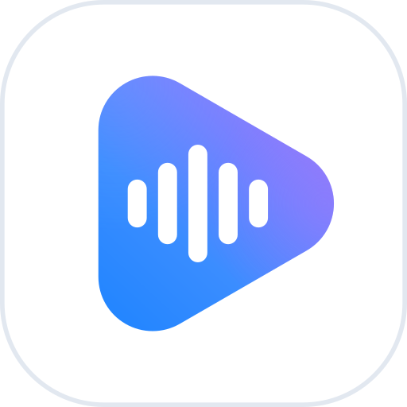
  <h1>Media Studio</h1>
  <p>
    A modern offline Android audio and video player (<code>com.android.multimediastudio</code>) built with <strong>Jetpack Compose</strong>, <strong>Material 3</strong>, <strong>Jetpack Media3 (ExoPlayer)</strong>, and native <strong>FFmpeg</strong> codec support.
  </p>
</div>

---

<h2 align="center">Screenshots</h2>

<h3 align="center">Library, Audio Player, PiP & Themes</h3>
<p align="center">
  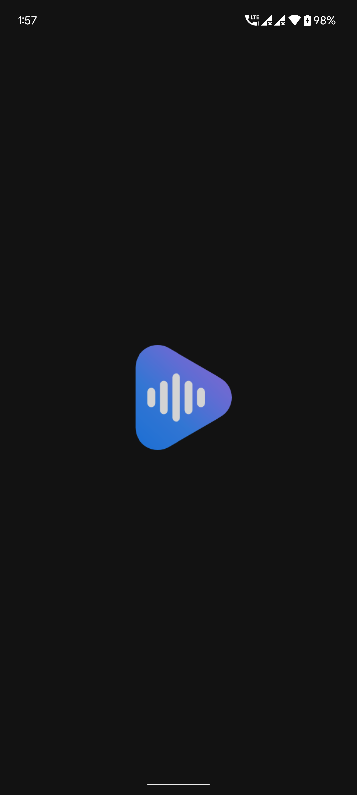
  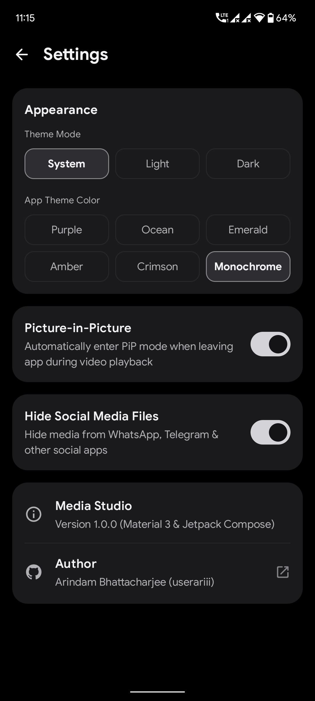
  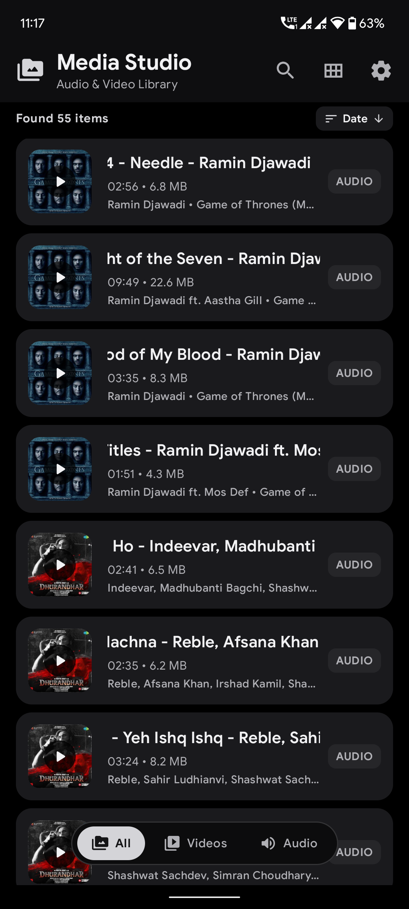
  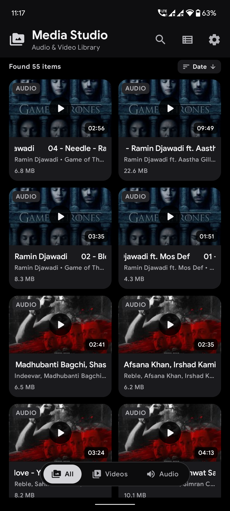
</p>

<p align="center">
  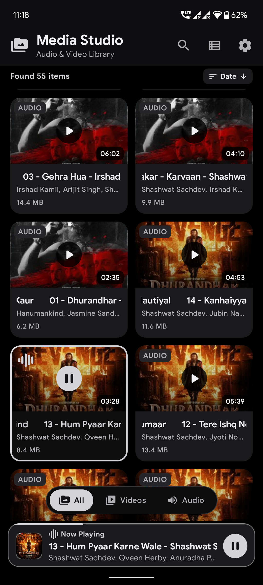
  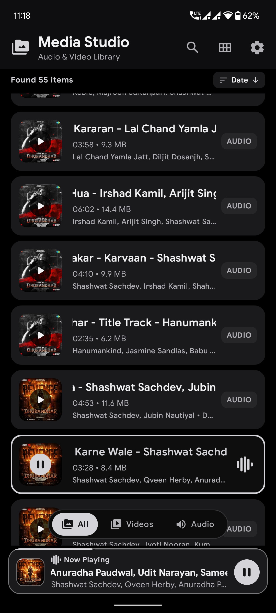
  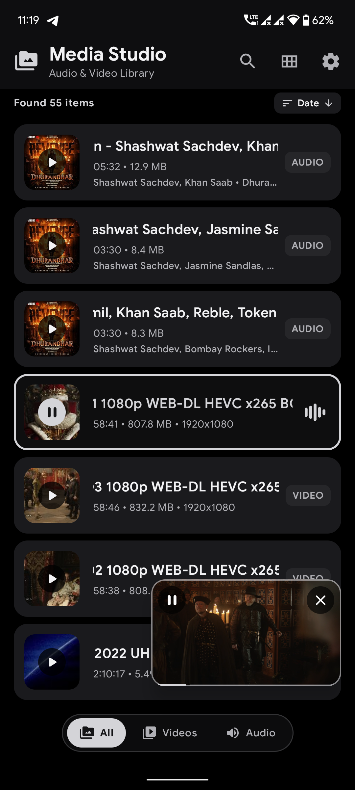
  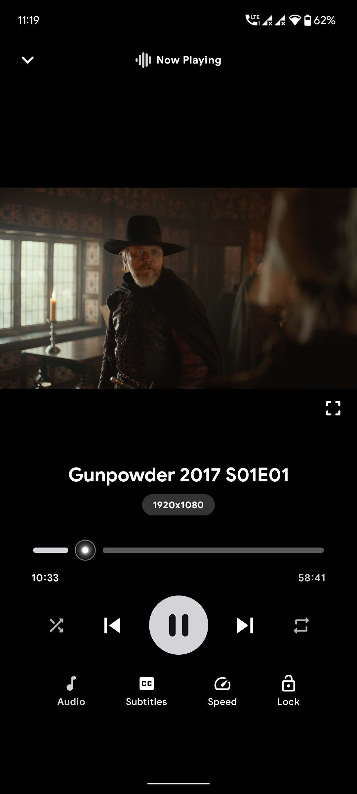
</p>

<p align="center">
  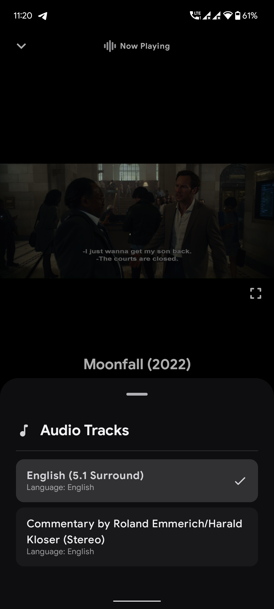
  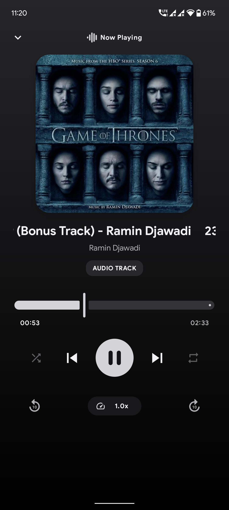
  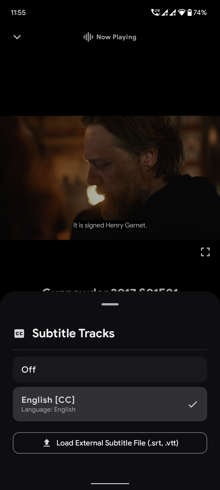
  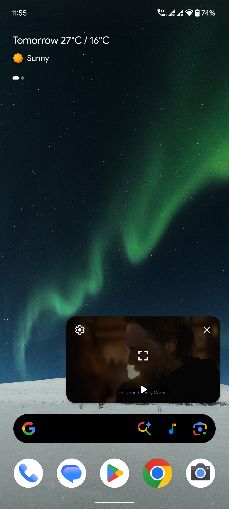
</p>

<h3 align="center">Landscape Video Player</h3>
<p align="center">
  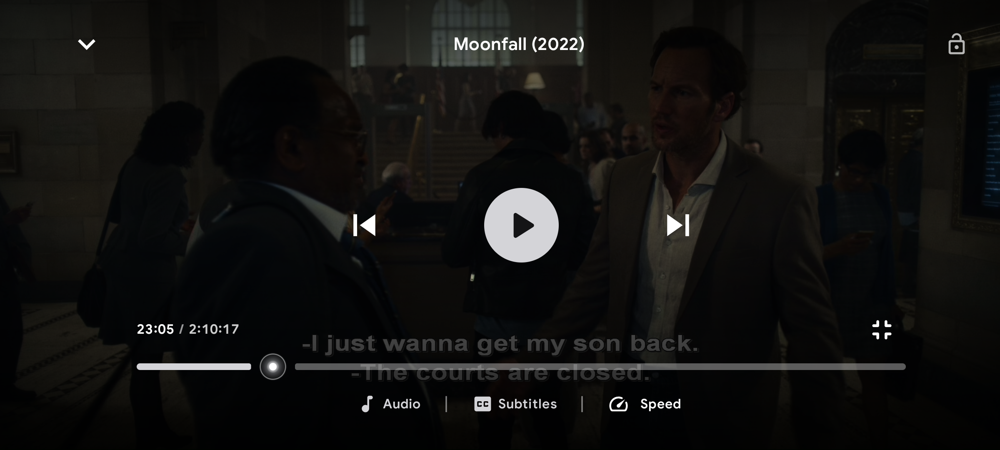
  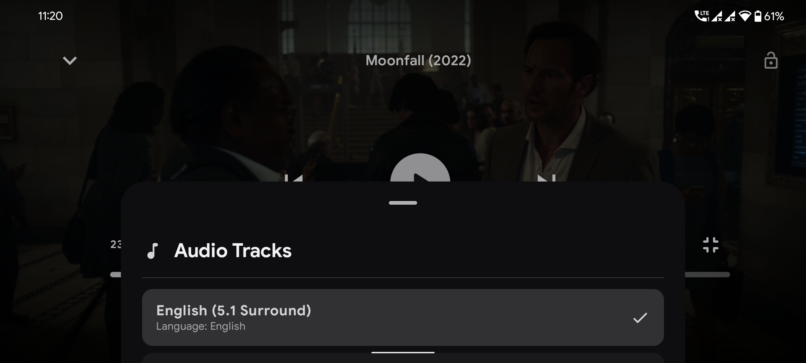
  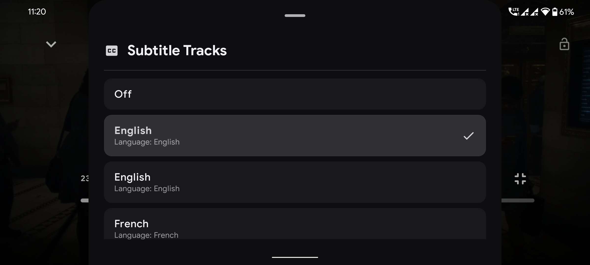
</p>

---

<h2 align="center">Features</h2>

<h3 align="center">Offline Audio & Video Library</h3>

- **Automatic Local Media Discovery**: Scans device storage via Android `MediaStore` with live `ContentObserver` incremental syncing so added or deleted files appear automatically.
- **Filter Tabs & Live Search**: Browse **All**, **Videos**, or **Audio** tabs with item counts, and search in real time by title, artist, album, resolution, or MIME type.
- **Flexible Sorting**: Sort by **Date Modified**, **Date Added**, **Name**, **Size**, or **Duration** in ascending or descending order (persisted across launches).
- **List & Grid Views**: Switch between List and Grid layouts featuring continuous **marquee scrolling** for long titles, duration/format chips, and cached album/video thumbnails (`Coil` + multi-stage `VideoThumbnailFetcher`).
- **Batch Multi-Select & Scoped Deletion**: Long-press to select multiple files for deletion with Android scoped-storage permission confirmation.
- **Social Media Filtering**: Optional setting to hide media from WhatsApp, Telegram, Instagram, TikTok, and other social apps.
- **Open External Files**: Launch `video/*` and `audio/*` files directly from file managers or other apps via `content://` and `file://` intents.

<h3 align="center">Video Player</h3>

- **Media3 ExoPlayer + Native FFmpeg**: Hardware-accelerated playback with bundled native **FFmpeg** (`libavcodec`, `libavutil`, `libswresample`) JNI extension rendering (`arm64-v8a`, `armeabi-v7a`, `x86`, `x86_64`) for broad format and audio codec compatibility.
- **Intuitive Touch Gestures**:
  - **Left vertical swipe**: Adjust screen brightness with live on-screen indicator.
  - **Right vertical swipe**: Adjust media volume with live on-screen indicator.
  - **Double-tap left / right**: Rewind or fast-forward in cumulative 10-second steps.
  - **Long-press hold**: Temporary `2.0x` playback speed boost while holding.
  - **Pinch-to-zoom & pan**: Zoom and pan video in landscape mode with Fit/Fill status feedback.
  - **Drag down**: Smoothly collapse into the mini-player or floating PiP preview.
- **Playback Controls & Track Management**:
  - Playback speed selector (`0.5x`, `1.0x`, `1.25x`, `1.5x`, `2.0x`), shuffle, and loop modes (`Off`, `Loop All`, `Loop One`).
  - **Audio Track Switcher**: Select between embedded multi-audio streams with language and channel info.
  - **Subtitle Support**: Switch embedded subtitle tracks or load external `.srt` / `.vtt` subtitle files.
  - **Screen Lock & Fullscreen**: Lock player touch controls to prevent accidental taps and toggle immersive landscape fullscreen.
  - **Adaptive Portrait & Landscape Video Handling**: Properly scales vertical reels/shorts as well as widescreen videos.

<h3 align="center">Audio Player & Background Playback</h3>

- **Dedicated Audio Screen**: Displays album artwork with a subtle playback pulse animation, animated waveform header indicator, marquee title, artist metadata, scrubbable seekbar, and full transport/speed controls.
- **Persistent Mini-Player**: Docked mini-player bar with quick play/pause and tap-to-expand while browsing the library.
- **Background Playback & Media Notification**: Powered by `MediaSessionService` (`PlaybackService`) with lock-screen/notification controls, queue skip support, audio focus handling, and automatic pause on headset disconnect.

<h3 align="center">Picture-in-Picture (PiP)</h3>

- **System PiP Mode**: Automatically enters Android Picture-in-Picture when leaving the app during video playback (toggleable in Settings), complete with native Play/Pause remote actions and automatic pause when dismissing the PiP window.
- **In-App Floating Video PiP**: Minimized draggable/resizable floating video preview inside the library pane.

<h3 align="center">Material 3 Theming & Customization</h3>

- **6 Curated Material 3 Color Palettes** (2×3 picker in Settings):
  - **Monochrome** *(default on first install — Pitch-Black `#000000` & crisp Grey/White)*
  - **Purple**
  - **Ocean**
  - **Emerald**
  - **Amber**
  - **Crimson**
- **Theme Modes**: **System**, **Light**, and **Dark** mode support with edge-to-edge UI and DataStore preference persistence.

---

<h2 align="center">Tech Stack</h2>

- **Language**: Kotlin `2.2.10` + C/C++ (JNI)
- **UI**: Jetpack Compose (BOM `2024.09.00`), Material 3, Adaptive Navigation
- **Media Engine**: AndroidX Media3 (`1.5.1` — ExoPlayer, Session, UI) + Native FFmpeg (`CMake`)
- **Image Loading**: Coil (`2.7.0`)
- **Persistence**: Jetpack DataStore Preferences + Room (`2.7.0`)
- **Build System**: Android Gradle Plugin `9.4.1`, KSP `2.3.5`, `compileSdk` / `targetSdk` `37`, `minSdk` `24`

---

<h2 align="center">How to Build</h2>

<h3 align="center">Prerequisites</h3>

1. **Android Studio** (recent release supporting AGP `9.4.1` and SDK `37`)
2. **Android SDK Platform 37** (`compileSdk = 37`, `targetSdk = 37`)
3. **Android NDK** & **CMake** (`3.21.0+`, required for `app/src/main/cpp/CMakeLists.txt`)
4. **Java / Gradle JVM**: Configured via `gradle/gradle-daemon-jvm.properties` (`toolchainVersion=25`, auto-provisioned via Foojay toolchain resolver) with Java `11` bytecode compatibility

<h3 align="center">Build & Run from Command Line</h3>

1. **Clone the repository**:
   ```bash
   git clone https://github.com/userariii/Media-Studio.git
   cd Media-Studio
   ```

2. **Build Debug APK**:
   ```bash
   ./gradlew :app:assembleDebug
   ```
   The generated APK will be at `app/build/outputs/apk/debug/app-debug.apk`.

3. **Build Release APK**:
   ```bash
   ./gradlew :app:assembleRelease
   ```

4. **Run Unit Tests**:
   ```bash
   ./gradlew :app:testDebugUnitTest
   ```

5. **Install directly onto a connected Android device or emulator**:
   ```bash
   ./gradlew :app:installDebug
   ```

---

<h2 align="center">Author</h2>

<p align="center">
  <strong>Arindam Bhattacharjee</strong> (<a href="https://github.com/userariii">@userariii</a>)
</p>
